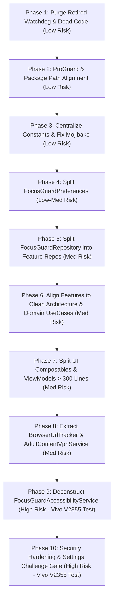

# 🛡️ FocusGuard Senior Architecture & Codebase Audit Report

**Date:** October 31, 2026  
**Auditor:** Senior Android Architect  
**Project:** FocusGuard (Android, Kotlin 2.0.21, Jetpack Compose, Room, DataStore, Hilt, AccessibilityService)  
**Target Hardware Verification Baseline:** Vivo V2355 (Funtouch OS / Android 15 & 16)  
**Scope:** Full codebase structure, layer discipline, God files, dependencies, dead code, naming conventions, security hygiene, build & test tooling, and refactoring roadmap.

---

## 1. Folder & Package Map

### 1.1 Package Inventory (2 Levels Deep)

The source root `app/src/main/java/com/focusguard/app` is severely fragmented into **19 top-level directories** containing 46 two-level nodes and 273 Kotlin source files:

| Directory (2 Levels Deep) | File Count | Total Lines of Code | Primary Role |
| :--- | :---: | :---: | :--- |
| `.` (Root) | 1 | 167 | Application subclass (`FocusGuardApplication.kt`) |
| `blockers/` | 7 | 1,634 | Interception engines (`ReelBlocker`, `AntiClonerEngine`, `SessionBlockManager`, etc.) |
| `capability/` | 2 | 555 | Permission and OEM capability evaluator (`CapabilityManager`) |
| `core/common/` | 2 | 376 | `AppResult` sealed class & `InputValidator` |
| `core/database/` | 20 | 720 | Room Database, DAOs (`BlockedAppDao`, etc.), Entities, Converters |
| `core/datastore/` | 1 | 1,001 | Monolithic Preferences Datastore (`FocusGuardPreferences.kt`) |
| `core/designsystem/` | 1 | 192 | Theme colors, typography, shapes |
| `core/di/` | 3 | 108 | Hilt modules (`CoroutinesModule`, `EngineModule`, `RulesModule`) |
| `core/engine/` | 9 | 320 | Block decision interfaces and default rule implementations |
| `core/model/` | 10 | 298 | Core domain model data classes |
| `data/repository/` | 6 | 2,057 | Monolithic `FocusGuardRepository` (1,369 lines) & subsidiary repos |
| `di/` | 2 | 91 | Orphaned Hilt modules (`DatabaseModule`, `FirebaseModule`) |
| `domain/usecase/` | 1 | 144 | Single use case (`GetInstalledAppsUseCase.kt`) |
| `feature/appblocker/` | 15 | 1,273 | Blocked Apps feature (UI & ViewModels) |
| `feature/auth/` | 15 | 1,529 | Authentication & Google Sign-In (UI, Domain, Data) |
| `feature/home/` | 15 | 2,061 | Dashboard home tab (UI, Domain, Data) |
| `feature/keywordblocker/` | 16 | 1,636 | Blocked keywords & websites (UI & ViewModels) |
| `feature/mindful/` | 18 | 1,607 | Mindful pause breathing flow (UI & ViewModels) |
| `feature/schedules/` | 21 | 1,629 | Recurring schedule blockers (UI & ViewModels) |
| `feature/session/` | 18 | 2,152 | Deep Focus kiosk mode (UI, Domain, Data) |
| `feature/settings/` | 21 | 3,120 | Settings tab, toggles, PIN/passcode setup (UI, Domain) |
| `feature/timelimits/` | 19 | 2,007 | Daily app time limits (UI & ViewModels) |
| `observer/` | 1 | 111 | `AccessibilityStateObserver.kt` |
| `overlay/deepfocus/` | 2 | 570 | Compose content for Deep Focus lockdown overlay |
| `overlay/manager/` | 1 | 429 | `BlockOverlayManager.kt` WindowManager controller |
| `overlay/mindful/` | 4 | 830 | Mindful breathing aura & intent selection Compose overlays |
| `overlay/standard/` | 2 | 484 | Standard block card overlay UI |
| `overlay/wallpaper/` | 1 | 137 | Custom overlay wallpaper renderer |
| `receiver/` | 4 | 583 | System BroadcastReceivers (`BootReceiver`, `NewAppInstallReceiver`, etc.) |
| `recovery/` | 1 | 331 | `AccessibilityRecoveryHelper.kt` |
| `security/` | 3 | 387 | `SupportCodeEngine.kt`, `PresetIntent.kt` |
| `service/` | 5 | 3,844 | Android Services (`FocusGuardAccessibilityService`, `BootCoverService`, etc.) |
| `service/handlers/` | 6 | 1,250 | Delegated accessibility handlers (`LauncherEventHandler`, etc.) |
| `service/utils/` | 1 | 141 | `PackageClassifier.kt` |
| `sync/` | 1 | 658 | `CloudSyncEngine.kt` (Firestore synchronization) |
| `tracker/` | 2 | 1,179 | `BrowserUrlTracker.kt` (980 lines) & metadata holder |
| `ui/block/` | 1 | 257 | `BlockParentScreen.kt` |
| `ui/capability/` | 1 | 249 | `CapabilityExplanationSheet.kt` |
| `ui/challenge/` | 6 | 1,036 | Challenge dialogs (`SentenceTypingChallengeDialog`, etc.) |
| `ui/components/` | 9 | 1,347 | Shared dialogs (`AccountabilityRequiredDialog`, `SearchField`, etc.) |
| `ui/limits/` | 1 | 215 | `LimitsParentScreen.kt` |
| `ui/navigation/` | 2 | 339 | `MainBottomBar.kt`, `MainContentPager.kt` |
| `ui/onboarding/` | 2 | 337 | `OnboardingActivity.kt`, `OnboardingViewModel.kt` |
| `ui/protection/` | 8 | 1,184 | OEM autostart & battery guidance UI screens |
| `ui/recovery/` | 2 | 518 | `AccessibilityRecoveryActivity.kt`, `AccessibilityRecoveryScreen.kt` |
| `ui/theme/` | 1 | 40 | Redundant proxy forwarding to `core/designsystem/theme` |
| `usage/` | 3 | 518 | `UsageStatsHelper.kt`, `TimeLimitEvaluator.kt` |
| `utils/` | 7 | 829 | Battery, SafeNode, LauncherDetector helpers |
| `worker/` | 3 | 351 | WorkManager periodic jobs (`MidnightResetWorker`, etc.) |

### 1.2 Structural Defects & Overlapping Packages

1. **`ui/` vs `feature/` Ambiguity:**
   Screens and dialogs are split inconsistently. Feature screens live under `feature/*/ui/`, but container screens live under `ui/block/` and `ui/limits/`, while challenge dialogs live under `ui/challenge/`.
2. **Dual Dependency Injection Roots (`di/` vs `core/di/`):**
   `DatabaseModule.kt` and `FirebaseModule.kt` reside in `app/di/`, while `CoroutinesModule.kt`, `EngineModule.kt`, and `RulesModule.kt` reside in `app/core/di/`.
3. **Data Layer Split (`data/repository/` vs `core/database/` vs `feature/*/data/`):**
   A monolithic `FocusGuardRepository` sits in `data/repository/`, Room DAOs sit in `core/database/`, and mini-repositories exist in `feature/auth/data` and `feature/home/data`.
4. **Redundant Theme Proxy:**
   `app/src/main/java/com/focusguard/app/ui/theme/Theme.kt` is a 40-line dummy file consisting purely of forwarded property aliases pointing to `com.focusguard.app.core.designsystem.theme.*`.
5. **Orphaned Root Packages:**
   `tracker/`, `sync/`, `recovery/`, `capability/`, `security/`, and `observer/` exist as loose top-level packages alongside `core/` and `feature/`, rather than being structured into core platform infrastructure or modular verticals.

---

## 2. Architecture Consistency

### 2.1 Feature Layer Compliance

Modern Android Clean Architecture requires features to maintain independent, unidirectional boundaries: `ui` -> `domain` -> `data`. FocusGuard exhibits severe inconsistency across its 9 business verticals:

| Feature Vertical | `ui` Present? | `domain` Present? | `data` Present? | Architecture Compliance Rating | Notes |
| :--- | :---: | :---: | :---: | :---: | :--- |
| `feature/auth` | Yes | Yes | Yes | **Full** | Only feature with complete repository, use case, and UI isolation. |
| `feature/home` | Yes | Yes | Yes | **Partial** | Uses domain use cases, but UI still directly binds `FocusGuardRepository`. |
| `feature/session` | Yes | Yes | Yes | **Partial** | Domain layer exists, but `SessionBlockManager` bypasses use cases. |
| `feature/settings` | Yes | Yes | No | **Broken** | Has domain use cases, but ViewModel directly controls Room DAOs. |
| `feature/appblocker` | Yes | **NO** | **NO** | **Severe Violation** | ViewModel injects Room DAOs & `FocusGuardRepository` directly. |
| `feature/keywordblocker` | Yes | **NO** | **NO** | **Severe Violation** | ViewModel injects `BlockedKeywordDao` directly. |
| `feature/mindful` | Yes | **NO** | **NO** | **Severe Violation** | ViewModel injects `MindfulAppDao` directly. |
| `feature/schedules` | Yes | **NO** | **NO** | **Severe Violation** | ViewModel injects `FocusScheduleDao` directly. |
| `feature/timelimits` | Yes | **NO** | **NO** | **Severe Violation** | ViewModel injects `TimeLimitDao` directly. |

### 2.2 Layer Violations & Data Leaks

1. **ViewModels Directly Injecting Room DAOs:**
   ```kotlin
   // AppBlockerViewModel.kt:33
   class AppBlockerViewModel @Inject constructor(
       private val blockedAppDao: BlockedAppDao, // VIOLATION: ViewModel touching database DAO
       private val repository: FocusGuardRepository
   )
   ```
   Directly violates MVVM and Clean Architecture: ViewModels in `appblocker`, `keywordblocker`, `mindful`, `schedules`, `settings`, and `timelimits` bypass all abstraction layers, rendering unit testing impossible without mocking SQLite persistence.

2. **UI Screens Directly Coupling with Database Entities:**
   Room `@Entity` classes (`BlockedAppEntity`, `BlockedKeywordEntity`, `ScheduleEntity`, `AppTimeLimitEntity`) are passed directly into Compose screens (`AppBlockerScreen.kt`, `ScheduleScreen.kt`, `TimeLimitScreen.kt`) and used as UI state models. Database schema changes immediately break UI rendering.

3. **Domain Layer Leaking Android Platform Classes:**
   - `com.focusguard.app.domain.usecase.GetInstalledAppsUseCase.kt` imports `android.content.Context` and `android.content.pm.PackageManager`. (This is an OS system service wrapper, not domain business logic).
   - `SettingsProtectionUseCase.kt`, `SettingsFeedUseCase.kt`, and `SettingsOverlayUseCase.kt` import Android framework classes.
   - `AuthRepository.kt` takes `android.content.Context` in domain interface contracts.

4. **Services Acting as Business Logic Controllers:**
   `FocusGuardAccessibilityService.kt` directly manages session timers, daily usage quotas, mindful breathing progression, and PIN/tamper rules instead of delegating to domain engines.

---

## 3. God Files & Large Files (> 300 Lines)

FocusGuard contains **21 Kotlin files exceeding the strict 300-line limit** defined in project rules:

| Line Count | File Path | Primary Cause of Bloat | Recommended Split Strategy |
| :---: | :--- | :--- | :--- |
| **2,185** | `service/FocusGuardAccessibilityService.kt` | God class handling event interception, timing, window state, PiP, Reels, and overlays. | Split into dedicated event processors: `WindowStateProcessor`, `ContentChangeProcessor`, `SessionTrackingProcessor`, and `MindfulPauseCoordinator`. |
| **1,369** | `data/repository/FocusGuardRepository.kt` | God repository managing 94 functions, 33 Flows, 12 in-memory caches, Room DAOs, and DataStore. | Split into feature repositories: `AppBlockingRepository`, `KeywordRepository`, `ScheduleRepository`, `TimeLimitRepository`, and `ProtectionRepository`. |
| **1,001** | `core/datastore/FocusGuardPreferences.kt` | Single file hosting 42 preference keys, getters, setters, and 27 reactive Flows. | Decompose into targeted preference stores: `ProtectionPreferences`, `FeedPreferences`, `OverlayPreferences`, and `OnboardingPreferences`. |
| **980** | `tracker/BrowserUrlTracker.kt` | Monolithic tracker scraping browser omniboxes, YouTube metadata, chat search queries, and keywords. | Decompose into: `BrowserOmniboxTracker`, `YouTubeMetadataExtractor`, `ChatQueryExtractor`, and `BrowserPackageRegistry`. |
| **658** | `sync/CloudSyncEngine.kt` | Single-handedly orchestrates bidirectional Firestore sync for 7 distinct domain entities. | Extract per-entity sync workers: `AppsSyncWorker`, `SchedulesSyncWorker`, `AccountabilitySyncWorker`, and a `CloudSyncCoordinator`. |
| **646** | `service/BootCoverService.kt` | FGS lifecycle + WindowManager UI injection + fallback countdown + recovery navigation. | Split into `BootCoverService` (lifecycle only), `BootCoverWindowManager` (UI presentation), and `BootRecoveryCoordinator`. |
| **571** | `service/AdultContentVpnService.kt` | Raw UDP RFC-1035 DNS packet decoder + 1,000+ hardcoded domains + SafeSearch DNS synthesis. | Split into: `DnsPacketCodec`, `AdultDomainRegistry`, `SafeSearchEnforcer`, and `AdultContentVpnService` (network loop). |
| **469** | `capability/CapabilityManager.kt` | Evaluates 7 permissions, OEM autostart, ContentObservers, and produces Android Intents. | Split into `PermissionStatusChecker`, `OemAutostartDetector`, and `CapabilityIntentFactory`. |
| **429** | `overlay/manager/BlockOverlayManager.kt` | WindowManager view hierarchy, Compose lifecycle, audio alert sirens, and haptic engine. | Split into `OverlayWindowManager`, `OverlayAudioAlertPlayer`, and `OverlayStateHolder`. |
| **405** | `blockers/ReelBlocker.kt` | Node tree scanner for Instagram, YouTube, Facebook, and Snapchat video players. | Extract app-specific scanners: `InstagramReelScanner`, `YouTubeShortsScanner`, `FacebookReelScanner`, `SnapchatSpotlightScanner`. |
| **349** | `utils/BatteryOptimizationHelper.kt` | Giant `when` switch containing hardcoded OEM battery intents for 10+ manufacturers. | Refactor into polymorphism: `OemBatteryStrategy` interface with vendor implementations (`VivoBatteryStrategy`, `XiaomiBatteryStrategy`, etc.). |
| **341** | `feature/settings/ui/components/SupportCodeVerificationContent.kt` | Giant Compose file with email intent triggers, dialog states, and PIN displays. | Break into sub-composables: `SupportCodeEmailCard.kt` and `SupportCodePinDisplay.kt`. |
| **339** | `blockers/AntiClonerEngine.kt` | UID calculation, reflection on `UserHandle`, and cloner package lists. | Split into `UserHandleReflectionGuard` and `ClonerPackageRegistry`. |
| **331** | `recovery/AccessibilityRecoveryHelper.kt` | Monitors accessibility health, writes to secure settings, and displays recovery UI. | Split into `AccessibilityHealthMonitor` and `SecureSettingsEnabler`. |
| **328** | `overlay/standard/BlockOverlayContent.kt` | Massive Compose screen rendering block presets, quotes, countdowns, and buttons. | Extract `BlockOverlayHeader.kt`, `BlockOverlayMessageCard.kt`, and `BlockOverlayActionButtons.kt`. |
| **320** | `service/handlers/SettingsEventHandler.kt` | Multi-vendor settings tamper handling and OEM iManager protection. | Split into `SystemSettingsTamperDetector` and `AccessibilitySettingsTamperDetector`. |
| **319** | `overlay/mindful/MindfulIntentSelectionView.kt` | Complex Compose view containing chips, timer selections, text inputs, and validation. | Split into `MindfulAllowanceChips.kt` and `MindfulIntentForm.kt`. |
| **318** | `feature/settings/ui/SettingsViewModel.kt` | Manages 25+ settings toggles, PIN verification, and 8 dialog states. | Extract delegated state handlers: `SettingsFeedDelegate` and `SettingsOverlayDelegate`. |
| **312** | `feature/home/ui/components/AccountabilityChallengeCard.kt` | Compose card managing active challenge countdowns, removal gates, and partner sync. | Extract sub-views: `ActiveChallengeStatusView.kt` and `ChallengeTypeSummaryView.kt`. |
| **311** | `feature/timelimits/ui/TimeLimitViewModel.kt` | Manages package usage querying, limits list filtering, and challenge prompts. | Extract search logic to `AppSearchDelegate` and limit validation to `TimeLimitUseCase`. |
| **309** | `feature/home/ui/components/HomeDialogsContainer.kt` | Massive container hosting 8 distinct modal dialogs. | Split into individual dialog hosts: `HomeProtectionDialogHost.kt` and `HomeAccountabilityDialogHost.kt`. |

---

## 4. Dependency & Coupling

### 4.1 Most Depended-On Classes (Coupling Bottlenecks)

1. **`FocusGuardRepository`:** Injected into **26 distinct classes** spanning ViewModels, Services, Receivers, and Workers. Any change to repository methods forces re-compilation of almost the entire project.
2. **`FocusGuardAccessibilityService`:** Direct coupling with handlers (`SettingsEventHandler` takes `service: FocusGuardAccessibilityService` as a parameter to call `performGlobalAction`).
3. **`SessionBlockManager`:** Injected across accessibility handlers, decision engines, and ViewModels.

### 4.2 Static Global State & Companion Objects

FocusGuard relies on several mutable static variables that bypass dependency injection and break process recreation isolation:

```kotlin
// FocusGuardAccessibilityService.kt
companion object {
    // Static variable surviving service recreation
    val oemScanSuppressUntilStatic = java.util.concurrent.atomic.AtomicLong(0L)
}

// AdultContentVpnService.kt
companion object {
    // Global static boolean tracking VPN runtime state
    val isRunning = AtomicBoolean(false)
}

// BootCoverService.kt
companion object {
    @Volatile
    var isOverlayAttached: Boolean = false
    @Volatile
    private var activeInstance: WeakReference<BootCoverService>? = null
}
```

*Architectural Hazard:* On Android 14+, OEM background kills recreate services under fresh `Application` classloaders while static companion fields can retain stale timestamps or point to leaked contexts inside `WeakReference`.

---

## 5. Dead & Duplicate Code

### 5.1 The Retired `ProtectionWatchdogService` Zombie

In `app/src/main/AndroidManifest.xml`:
```xml
<!-- Lines 138-140 -->
<service
    android:name=".service.ProtectionWatchdogService"
    android:exported="false"
    android:enabled="false" />
```
The service is explicitly disabled in the manifest, and its internal code states:
`Log.i(TAG, "ProtectionWatchdogService is retired — stopping immediately to remove FGS warning.")`
Yet:
- The full **267-line class** `ProtectionWatchdogService.kt` still exists.
- Invocations of `ProtectionWatchdogService.stopService(...)` remain in `FocusGuardApplication.kt` (L95), `BootReceiver.kt` (L110), `FocusGuardAccessibilityService.kt` (L371), and `OnboardingActivity.kt` (L69).
- A redundant rule remains in `app/proguard-rules.pro` (L3): `-keep class com.focusguard.app.service.ProtectionWatchdogService { *; }`.

### 5.2 Uncollected Reactive Flows

In `FocusGuardRepository.kt:1015`:
```kotlin
val securityEvents: Flow<List<SecurityEvent>> = eventDao.observeAll()
```
This Flow is defined and backed by Room DAO observations, but **zero collectors exist in the entire codebase**. It consumes DAO allocation overhead without ever surfacing events to the UI.

### 5.3 Redundant Theme Proxy

`app/src/main/java/com/focusguard/app/ui/theme/Theme.kt` is a 40-line file that merely imports and re-aliases colors from `core/designsystem/theme/Theme.kt`.

---

## 6. Naming & Conventions

### 6.1 Magic Numbers & Hardcoded Constants

Critical operational timeouts and threshold numbers are scattered across business logic instead of centralized in configuration constants:

| Magic Number | File & Location | Purpose / Risk | Recommended Constant |
| :---: | :--- | :--- | :--- |
| `2500L` | `FocusGuardAccessibilityService.kt:781` | Post-overlay dismissal debounce cooldown. | `ServiceConstants.OVERLAY_DISMISS_COOLDOWN_MS` |
| `1500L` | `FocusGuardAccessibilityService.kt:1067` | Event debounce window for package transitions. | `ServiceConstants.TRANSITION_DEBOUNCE_MS` |
| `40L` | `FocusGuardAccessibilityService.kt:800` | Notification shade collapse rate limiter. | `ServiceConstants.SHADE_COLLAPSE_THROTTLE_MS` |
| `200L` | `FocusGuardAccessibilityService.kt:1075` | Minimum duration required to log app session. | `SessionConstants.MIN_RECORDABLE_SESSION_MS` |
| `35s` | `BootCoverService.kt` | Fallback timeout to release boot screen. | `BootConstants.FALLBACK_TIMEOUT_SECONDS` |
| `100000` | `FocusGuardApplication.kt` / `AntiClonerEngine.kt` | UID division offset to detect secondary user / clone. | `SecurityConstants.PER_USER_UID_RANGE` |
| `9001` / `9901` | `AdultContentVpnService.kt`, `ProtectionWatchdogService.kt` | Hardcoded foreground notification IDs. | `NotificationConstants.ID_VPN_SERVICE`, etc. |

### 6.2 Hardcoded Package Names & View IDs

1. **Scattered OEM Package Strings:**  
   Strings such as `"com.bbk.launcher2"`, `"com.vivo.imanager"`, `"com.android.settings"`, and `"com.vivo.safecenter"` are duplicated across 14+ files instead of being unified into a single `OemPackageConstants` registry.
2. **Hardcoded UI Node Resource IDs:**  
   In `ReelBlocker.kt`:  
   `"com.instagram.android:id/reel_viewer_container"`, `"com.google.android.youtube:id/shorts_container"`, `"com.facebook.katana:id/viewer_root"`.  
   If vendor apps update obfuscated resource IDs, detection fails silently with zero compiler warnings.

### 6.3 Encoding Corruption (Mojibake)

Several source files contain corrupted UTF-8 multi-byte characters caused by mismatched Windows-1252 / UTF-8 editor saves:
- `ProtectionWatchdogService.kt:61`: `Log.i(TAG, "ProtectionWatchdogService is retired  stopping immediately...")`
- `FocusGuardAccessibilityService.kt:2104`: `* STATIC AtomicLong  survives AccessibilityService instance restarts.`

---

## 7. Security & Safety Review

> [!CAUTION]
> These vulnerabilities represent potential vectors for bypass or security review rejection. No fixes have been applied in this audit step.

### 7.1 Missing Challenge Gate on Settings Tab

In `MainContentPager.kt` (L200–240), navigation to `MainTab.SETTINGS` is **completely unprotected**:
- Any person holding the unlocked device can switch to the Settings tab without entering a challenge or passcode.
- Inside Settings, the user can freely toggle:
  - Adult Content DNS filter (`onToggleAdultContentBlock`)
  - Unsupported Browser blocking (`onToggleBlockUnsupportedBrowsers`)
  - Instagram Reels / Facebook Reels / YouTube Shorts blocking (`onToggleShortsReelsBlock`)
  - Auto-block new apps (`onToggleAutoBlockNewApps`)
  - Overlay styles, countdowns, and wallpapers
- Only *disabling uninstall protection* or *modifying the active challenge* prompts the user for verification. A user during an impulse spike can disable all content filters and web protections directly from Settings with zero friction!

### 7.2 Exported Component Attack Surface

In `app/src/main/AndroidManifest.xml`:
```xml
<!-- Lines 239-248 -->
<receiver
    android:name=".receiver.PackageRemovedReceiver"
    android:enabled="true"
    android:exported="true">
    <intent-filter>
        <action android:name="android.intent.action.PACKAGE_REMOVED" />
        <action android:name="android.intent.action.PACKAGE_CHANGED" />
        <data android:scheme="package" />
    </intent-filter>
</receiver>
```
`PackageRemovedReceiver` is `exported="true"` without requiring any permission. While `PACKAGE_REMOVED` is a protected broadcast from the system, malicious apps on older Android versions or via spoofed intents can send explicit broadcasts to this receiver, triggering anti-clone recovery loops or resetting accessibility recovery alarms.

### 7.3 Plaintext Support Passcode Secret in APK

In `app/build.gradle.kts`:
```kotlin
buildConfigField("String", "SUPPORT_MASTER_SECRET", "\"$supportMasterSecret\"")
```
`SUPPORT_MASTER_SECRET` is embedded directly into `BuildConfig.java` as a plaintext string constant. Anyone running `jadx-gui` or `strings classes.dex` on the release APK can extract the master secret in seconds and calculate valid support bypass codes for any device without contacting support!

### 7.4 Sensitive User Data in Logcat

In `BrowserUrlTracker.kt`, captured search queries and raw visited URL strings are emitted to Android Logcat under `Log.d`:
```kotlin
Log.d(TAG, "Extracted search query: $query for package: $pkg")
```
Any app with `READ_LOGS` on rooted devices or via USB debugging (`adb logcat`) can passively harvest user browsing history in real time.

---

## 8. Build, Tests & Tooling

### 8.1 Build System & Gradle Architecture

- **Single Module Monolith:** The entire app resides in a single `:app` Gradle module. Compilation times suffer because Gradle cannot parallelize feature builds.
- **Version Catalog:** Good practice — dependencies are managed cleanly via `gradle/libs.versions.toml`.
- **Static Analysis Tools:** **Completely absent.** There is no Detekt, Ktlint, Spotless, or Android Lint configuration in `build.gradle.kts`. Code style and line count limits are enforced purely by voluntary discipline.
- **CI/CD:** There is **zero CI configuration** (the `.github` directory does not exist). Pull requests and commits are not validated by automated cloud runners.

### 8.2 Test Suite Analysis

The test suite contains **103 unit tests across 9 test files**:

```
blockers/KeywordBlockerTest.kt                      |  3 tests
core/common/validator/InputValidatorExtendedTest.kt  | 10 tests
core/common/validator/InputValidatorTest.kt         | 36 tests
core/database/DatabaseMigrationsTest.kt             |  2 tests
core/engine/DefaultBlockDecisionEngineTest.kt       |  4 tests
core/engine/rules/RulesTest.kt                      |  4 tests
feature/settings/SettingsViewModelFeedToggleTest.kt  |  8 tests
security/SupportCodeEngineTest.kt                   | 32 tests
service/utils/PackageClassifierTest.kt              |  4 tests
─────────────────────────────────────────────────────────────
Total:                                              | 103 tests
```

#### Massive Coverage Blindspot (>90% Untested Code)
Notice the skew:
- `InputValidatorTest` (46 tests) and `SupportCodeEngineTest` (32 tests) account for **78 of the 103 tests (76%)**.
- The following mission-critical components have **ZERO unit tests**:
  - `FocusGuardAccessibilityService.kt` (2,185 lines)
  - `FocusGuardRepository.kt` (1,369 lines)
  - `FocusGuardPreferences.kt` (1,001 lines)
  - `BrowserUrlTracker.kt` (980 lines)
  - `CloudSyncEngine.kt` (658 lines)
  - `BootCoverService.kt` (646 lines)
  - `AdultContentVpnService.kt` (571 lines)
  - `LauncherTargetResolver.kt`, `LauncherPopupDetector.kt`, `LauncherEventHandler.kt`
  - `SettingsEventHandler.kt`, `PackageInstallerHandler.kt`, `KeyEventHandler.kt`
  - `BlockOverlayManager.kt`
  - ViewModels: `AppBlockerViewModel`, `KeywordBlockerViewModel`, `MindfulAppsViewModel`, `ScheduleViewModel`, `TimeLimitViewModel`, `HomeViewModel`, `SessionViewModel`.

### 8.3 ProGuard / R8 Rules Obsolescence

In `app/proguard-rules.pro`:
```proguard
# Lines 13, 18, 23, 24
-keep class com.focusguard.app.data.db.Converters { *; }
-keep interface com.focusguard.app.data.db.*Dao { *; }
-keep class com.focusguard.app.data.model.** { *; }
-keep class com.focusguard.app.data.db.** { *; }
```
The package `com.focusguard.app.data.db` **does not exist** (Room is located in `com.focusguard.app.core.database`). Consequently, these keep rules are invalid stubs, and release builds with R8 minification risk stripping DAOs and Entity constructors.

---

## 9. Documentation Audit

1. **"The 10 Invariant Rules" vs 12 Rules:**  
   In `README.md` (L470), the section header proclaims:  
   `## 🛡️ The 10 Invariant Rules (Strict Architectural Principles)`  
   Yet lines 472 to 497 explicitly enumerate **12 rules** (Rule 1 through Rule 12).
2. **False Badge Claims:**  
   In `README.md` (L8):  
   `[](#)`  
   This badge is misleading. As proven in Section 3, **21 files exceed 300 lines**, with the core service reaching 2,185 lines and the repository reaching 1,369 lines.
3. **Outdated Directory Tree:**  
   The catalog in `README.md` describes an idealized feature layout that does not reflect the current 19 top-level packages.

---

## 10. Architectural Scorecard

| Area | Grade | Justification |
| :--- | :---: | :--- |
| **Structure** | **D** | 19 top-level folders; overlapping `ui/` vs `feature/`, `di/` vs `core/di/`. |
| **Architecture** | **D+** | 6 of 9 features have no domain/data layer; ViewModels directly touch Room DAOs. |
| **File Size** | **F** | 21 God files > 300 lines; service is 2,185 lines; repository is 1,369 lines. |
| **Coupling** | **D** | Monolithic repository injected into 26 classes; static companion state across services. |
| **Naming** | **C+** | Decent Compose naming, but magic numbers, scattered package strings, and mojibake remain. |
| **Testing** | **F** | 76% of tests test string validation/hashing; 0% test core services, repos, or handlers. |
| **Security Hygiene** | **C** | Settings tab lacks challenge gate; plaintext master secret in BuildConfig. |
| **Documentation** | **C-** | README claims "10 Rules" but lists 12; claims "< 300 lines" badge while 21 files violate it. |

---

## 11. Proposed Target Structure

Target architecture: **Feature-Centric Clean Architecture + Consolidated Platform Core**.  
Every single file is strictly maintained under **300 lines**.

```
app/src/main/java/com/focusguard/app/
├── FocusGuardApp.kt
├── core/
│   ├── common/             # AppResult, BaseViewModel, StringUtils
│   ├── database/           # Room Database, Converters, Migration
│   ├── datastore/          # Base DataStore wrapper
│   ├── designsystem/       # Material 3 Theme, Typography, ColorTokens
│   ├── di/                 # Consolidated Hilt modules (Database, Coroutines, Network)
│   ├── model/              # Pure domain models (AppInfo, BlockTarget, Challenge)
│   ├── oem/                # OEM Autostart, Battery strategies (Vivo, Xiaomi, Samsung)
│   └── security/           # Device Admin, SupportCodeEngine, AntiClonerGuard
├── feature/
│   ├── appblocker/         # ui/ (Screen, VM, State), domain/ (UseCases), data/ (Repo)
│   ├── auth/               # ui/, domain/, data/ (Google Sign-In, Firebase Auth)
│   ├── home/               # ui/, domain/, data/ (Dashboard, Cards, Metrics)
│   ├── keywordblocker/     # ui/, domain/, data/ (Websites, Adult Keywords)
│   ├── mindful/            # ui/, domain/, data/ (Breathing, Intent Selection)
│   ├── schedules/          # ui/, domain/, data/ (Recurring Schedules)
│   ├── session/            # ui/, domain/, data/ (Deep Focus Kiosk Mode)
│   ├── settings/           # ui/, domain/, data/ (Toggles, PIN, Challenge Setup)
│   └── timelimits/         # ui/, domain/, data/ (App Usage Limits)
├── service/
│   ├── accessibility/      # FocusGuardAccessibilityService + Modular Processors
│   │   ├── FocusGuardAccessibilityService.kt (< 300 lines)
│   │   ├── WindowStateProcessor.kt
│   │   ├── ContentChangeProcessor.kt
│   │   └── SessionTrackingProcessor.kt
│   ├── handlers/           # Launcher, Settings, Installer, Key handlers
│   ├── overlay/            # BlockOverlayManager, WindowManager, Compose Views
│   ├── vpn/                # AdultContentVpnService, DnsCodec, SafeSearch
│   ├── bootcover/          # BootCoverService, BootWindowManager
│   └── utils/              # PackageClassifier, SafeNodeUtils
└── sync/                   # CloudSyncCoordinator & per-entity sync workers
```

### File Migration & Split Mapping

| Current Path | Target Path(s) | Status |
| :--- | :--- | :---: |
| `service/FocusGuardAccessibilityService.kt` (2,185 L) | `service/accessibility/FocusGuardAccessibilityService.kt`<br>`service/accessibility/WindowStateProcessor.kt`<br>`service/accessibility/ContentChangeProcessor.kt`<br>`service/accessibility/SessionTrackingProcessor.kt` | **Split into 4 files** |
| `data/repository/FocusGuardRepository.kt` (1,369 L) | `feature/appblocker/data/AppBlockerRepositoryImpl.kt`<br>`feature/keywordblocker/data/KeywordRepositoryImpl.kt`<br>`feature/timelimits/data/TimeLimitRepositoryImpl.kt`<br>`feature/schedules/data/ScheduleRepositoryImpl.kt`<br>`feature/settings/data/ProtectionRepositoryImpl.kt` | **Split into 5 repositories** |
| `core/datastore/FocusGuardPreferences.kt` (1,001 L) | `core/datastore/ProtectionPreferences.kt`<br>`core/datastore/FeedPreferences.kt`<br>`core/datastore/OverlayPreferences.kt`<br>`core/datastore/OnboardingPreferences.kt` | **Split into 4 stores** |
| `tracker/BrowserUrlTracker.kt` (980 L) | `service/tracker/BrowserOmniboxTracker.kt`<br>`service/tracker/YouTubeMetadataExtractor.kt`<br>`service/tracker/ChatQueryExtractor.kt`<br>`service/tracker/BrowserPackageRegistry.kt` | **Split into 4 files** |
| `sync/CloudSyncEngine.kt` (658 L) | `sync/CloudSyncCoordinator.kt`<br>`sync/worker/AppsSyncWorker.kt`<br>`sync/worker/SchedulesSyncWorker.kt`<br>`sync/worker/AccountabilitySyncWorker.kt` | **Split into 4 files** |
| `service/BootCoverService.kt` (646 L) | `service/bootcover/BootCoverService.kt`<br>`service/bootcover/BootCoverWindowManager.kt`<br>`service/bootcover/BootRecoveryCoordinator.kt` | **Split into 3 files** |
| `service/AdultContentVpnService.kt` (571 L) | `service/vpn/AdultContentVpnService.kt`<br>`service/vpn/DnsPacketCodec.kt`<br>`service/vpn/AdultDomainRegistry.kt`<br>`service/vpn/SafeSearchEnforcer.kt` | **Split into 4 files** |
| `di/DatabaseModule.kt`, `di/FirebaseModule.kt` | `core/di/DatabaseModule.kt`, `core/di/FirebaseModule.kt` | **Move to `core/di`** |
| `ui/theme/Theme.kt` (40 L) | **DELETE** (Use `core/designsystem/theme/Theme.kt`) | **Delete** |
| `service/ProtectionWatchdogService.kt` (267 L) | **DELETE** + Remove from Manifest & ProGuard | **Delete** |

---

## 12. Phased Refactor Roadmap

Ordered strictly from **safest to riskiest**. Each phase is independently buildable and verifiable.



### Phase Details

1. **Phase 1: Dead Code & Retired Service Purge (Risk: LOW)**
   - Delete `ProtectionWatchdogService.kt` (267 lines).
   - Remove `<service android:name=".service.ProtectionWatchdogService" />` from `AndroidManifest.xml`.
   - Remove all `stopService` calls from `FocusGuardApplication`, `BootReceiver`, `FocusGuardAccessibilityService`, and `OnboardingActivity`.
   - Remove dead `securityEvents` Flow from `FocusGuardRepository`.
   - Delete redundant `app/src/main/java/com/focusguard/app/ui/theme/Theme.kt`.
   - *Verification:* `.\gradlew.bat testDebugUnitTest` and `.\gradlew.bat assembleDebug`.

2. **Phase 2: ProGuard Rules & Package Path Alignment (Risk: LOW)**
   - Consolidate `app/di/` into `app/core/di/`.
   - Fix outdated `com.focusguard.app.data.db.**` keep rules in `proguard-rules.pro` to point to `core.database.**`.
   - *Verification:* Run release minify build (`.\gradlew.bat assembleRelease`).

3. **Phase 3: Centralize Constants, Magic Numbers & Encoding Fixes (Risk: LOW)**
   - Create `core/common/constants/ServiceConstants.kt`, `OemPackageConstants.kt`, and `NotificationConstants.kt`.
   - Replace magic numbers (`2500L`, `1500L`, `40L`, `200L`, `100000`, `9901`) with named constants.
   - Re-encode corrupted UTF-8 mojibake characters in source comments.
   - *Verification:* Unit test suite execution.

4. **Phase 4: Decompose `FocusGuardPreferences.kt` (Risk: LOW-MEDIUM)**
   - Split the 1,001-line file into 4 focused preference stores under `core/datastore/`: `ProtectionPreferences`, `FeedPreferences`, `OverlayPreferences`, and `OnboardingPreferences`.
   - Maintain the underlying DataStore file name so user settings are preserved with zero migration loss.
   - *Verification:* Unit test preference serialization.

5. **Phase 5: Split `FocusGuardRepository.kt` into Domain Repositories (Risk: MEDIUM)**
   - Break the 1,369-line God repository into feature-bounded repositories:
     - `AppBlockingRepository`
     - `KeywordRepository`
     - `ScheduleRepository`
     - `TimeLimitRepository`
     - `ProtectionRepository`
   - *Verification:* All 103 unit tests must pass cleanly.

6. **Phase 6: Align Features to Clean Architecture & Remove DAO Access from ViewModels (Risk: MEDIUM)**
   - Create domain use cases for `appblocker`, `keywordblocker`, `mindful`, `schedules`, and `timelimits`.
   - Remove direct Room DAO injection from `AppBlockerViewModel`, `KeywordBlockerViewModel`, `MindfulAppsViewModel`, `ScheduleViewModel`, `SettingsViewModel`, and `TimeLimitViewModel`.
   - Map Room Entities to pure domain models before exposing to UI state.
   - *Verification:* Add unit tests for each ViewModel and use case.

7. **Phase 7: Split UI Composables & ViewModels Exceeding 300 Lines (Risk: MEDIUM)**
   - Decompose `SupportCodeVerificationContent.kt`, `BlockOverlayContent.kt`, `MindfulIntentSelectionView.kt`, `AccountabilityChallengeCard.kt`, `HomeDialogsContainer.kt`, and `SettingsViewModel.kt`.
   - *Verification:* Manual UI walkthrough of dashboard, settings, and dialogs.

8. **Phase 8: Extract `BrowserUrlTracker.kt` & `AdultContentVpnService.kt` (Risk: MEDIUM)**
   - Extract `DnsPacketCodec.kt` and `AdultDomainRegistry.kt` from `AdultContentVpnService.kt`.
   - Extract `YouTubeMetadataExtractor.kt` and `BrowserOmniboxTracker.kt` from `BrowserUrlTracker.kt`.
   - Add unit tests for DNS packet encoding/decoding and URL parsing.
   - *Verification:* Verify DNS filtering in browser with adult search keywords.

9. **Phase 9: Deconstruct `FocusGuardAccessibilityService.kt` into Event Processors (Risk: HIGH)**
   - **MANDATORY HARDWARE TEST ON VIVO V2355:**
     - Extract `WindowStateProcessor.kt`, `ContentChangeProcessor.kt`, `SessionTrackingProcessor.kt`, and `MindfulPauseCoordinator.kt`.
     - Reduce service orchestrator to < 300 lines.
   - *Verification:* Long-press FocusGuard on Vivo launcher (`com.bbk.launcher2`), verify overlay appears and kills popup; verify YouTube/WhatsApp long-press remains untouched.

10. **Phase 10: Security Hardening & Settings Challenge Gate (Risk: HIGH)**
    - **MANDATORY HARDWARE TEST ON VIVO V2355:**
      - Gate the Settings tab behind an active Accountability Challenge if uninstall protection or strict mode is active.
      - Add permission verification check to `PackageRemovedReceiver`.
      - Externalize support passcode derivation from plaintext `BuildConfig` constants.
    - *Verification:* Full tamper test on device: attempt to disable protections from inside Settings and from Vivo iManager.

---

## 13. Rules for AI Agents (The 20 Invariant Development Laws)

To ensure this codebase remains clean, maintainable, and bug-free during automated refactoring, all AI agents must follow these 20 strict laws:

### Architecture & Layer Boundaries
1. **DO NOT inject Room DAOs into ViewModels.** ViewModels must communicate exclusively through Domain UseCases or Repository interfaces.
2. **DO NOT pass Room `@Entity` classes into Compose UI.** Always map database entities to immutable domain models or UiState models.
3. **DO NOT import Android framework classes (`android.*`) into pure domain layers.** Domain contracts and use cases must remain 100% platform-agnostic (with the exception of Android-specific Intent dispatchers in presentation).
4. **DO NOT create circular dependencies between Services and Handlers.** Handlers must receive primitive events and return immutable actions or sealed decisions rather than holding direct references to the `AccessibilityService`.

### File Size & Clean Code (Rule 12 Invariant)
5. **DO NOT write any file longer than 300 lines.** If an existing file approaches 280 lines, you must propose an architectural split before adding new functionality.
6. **DO separate distinct responsibilities into separate files.** A feature vertical must have dedicated files for `Screen.kt`, `ViewModel.kt`, `UiState.kt`, `UiEvent.kt`, and `UseCase.kt`.
7. **DO NOT create duplicate or proxy files.** Never create alias forwarding files like `ui/theme/Theme.kt` to paper over package mismatches.

### State & Concurrency
8. **DO NOT use static mutable variables (`companion object { var ... }`) for runtime state.** Use Hilt-managed `@Singleton` state holders to preserve process recreation boundaries.
9. **DO NOT execute synchronous Room queries or disk I/O on the main thread.** Accessibility event pipelines must rely strictly on in-memory caches and non-blocking Coroutine flows.
10. **DO NOT declare uncollected Flows.** If a repository exposes a reactive `Flow`, it must have an active subscriber or be refactored into a suspend function.

### Security & Invariants
11. **DO enforce "Overlay First, Then Home" (Rule 1).** Always mount the WindowManager overlay before dispatching `GLOBAL_ACTION_HOME`.
12. **DO enforce Self-Package Exclusion on line 1 of event handling.** The first statement in any accessibility pipeline must discard `com.focusguard.app`.
13. **DO gate all protective settings behind active challenges.** Never allow toggling adult filters, browser blockers, or uninstall shields without completing the configured friction gate.
14. **DO NOT log sensitive user data.** Visited URLs, web search queries, and passcodes must never be written to Android Logcat in plain text.
15. **DO NOT hardcode secrets in source or BuildConfig.** Master secrets must never be embedded in plaintext strings that can be extracted from compiled DEX bytecodes.

### Testing & Verification
16. **DO write unit tests for every new class or extracted handler.** A refactoring step is incomplete until accompanied by automated JUnit verification.
17. **DO run `testDebugUnitTest` and `assembleDebug` after every file modification.** Never report completion of a step until the Gradle compiler confirms zero errors.
18. **DO verify critical accessibility behavior on physical OEM hardware (Vivo V2355).** Emulators do not replicate Vivo iManager, ColorOS power controllers, or Samsung Knox background killers.

### Conventions & Naming
19. **DO centralize magic numbers and package names in named constants.** Never write raw timing literals like `2500L` or raw package strings like `"com.bbk.launcher2"` inside business logic.
20. **DO maintain UTF-8 encoding integrity.** Never save source files with corrupted encoding artifacts or broken mojibake characters.

